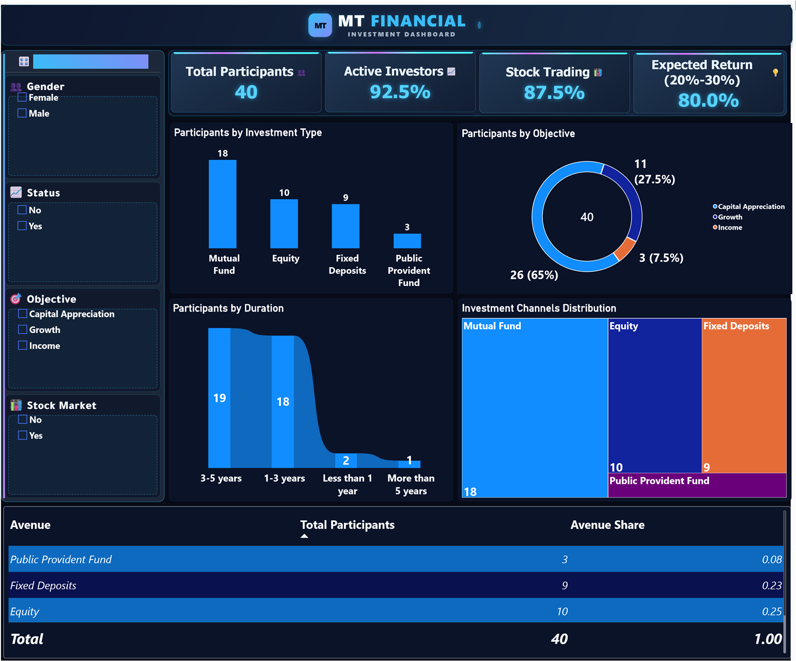

# MT Finance - Investment Preferences Dashboard

A Power BI dashboard that turns a 40-response investor survey into a clear view of what people invest in, why, for how long, and through which channel.



## Overview

| Item | Detail |
|---|---|
| Responses | 40 survey participants |
| Tooling | Power BI Desktop, DAX, HTML/CSS cards, native visuals |
| Filters | Four slicers covering the main survey dimensions |
| Focus | Investment avenues, objectives, duration, and channels |

## What the dashboard shows

- **Summary cards** - total participants, active investors, stock trading participation, and expected return.
- **Participants by investment type** - mutual funds, equity, fixed deposits, and public provident fund.
- **Participants by objective** - capital appreciation, growth, and income.
- **Participants by duration** - less than 1 year, 1-3 years, 3-5 years, and more than 5 years.
- **Investment channels distribution** - treemap of how the sample allocates across avenues.
- **Avenue summary table** - participants and share for each investment avenue.

Four slicers (gender, status, objective, stock market) let the viewer isolate a segment and have every visual respond at once.

## Dataset

`data/Finance_data.csv` contains 40 responses and 24 fields, including:

- Demographics: gender, age.
- Avenue ranking: mutual funds, equity market, debentures, government bonds, fixed deposits, PPF, gold.
- Behaviour: investment objective, purpose, preferred duration, monitoring frequency, expected return.
- Preferences: savings objective, reasons for each avenue, and information source.

`data/Original_data.csv` keeps the original column labels for traceability.

## Repository contents

```text
mt-finance-investment-dashboard/
|-- MT_Finance_Investment_Dashboard.pbix
|-- assets/
|   `-- dashboard.png
|-- data/
|   |-- Finance_data.csv
|   `-- Original_data.csv
`-- README.md
```

## How to open

1. Open `MT_Finance_Investment_Dashboard.pbix` in Power BI Desktop.
2. If prompted, allow the HTML Content custom visual used by the summary cards.
3. Use the slicers to move from the full sample to a specific investor segment.

## Data notes

- The survey is a small illustrative sample and is not a statistically representative study.
- The project name is independent; it is not affiliated with any financial institution.
- No personally identifying information is included in the dataset.

## Author

**Mohamed Mahmoud Taha** - Financial Analyst | Data Analyst

GitHub: [momahmoud02](https://github.com/momahmoud02)
